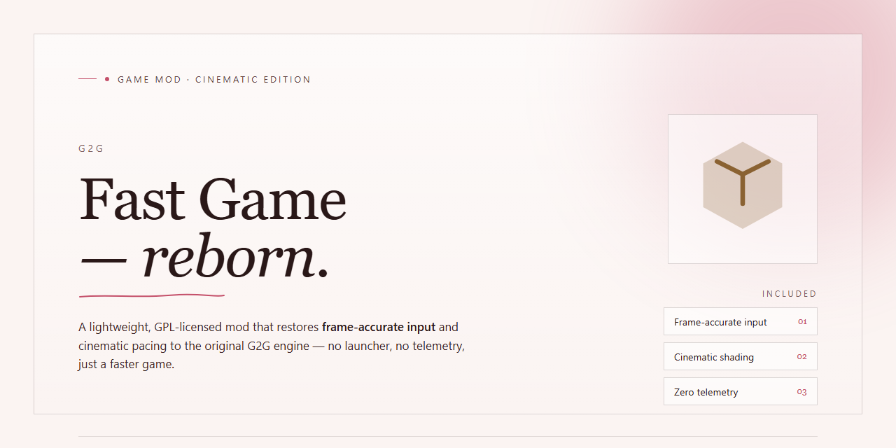

# ⚡ G2G Fast Game — Bunny Hop & Surf Timer Speed Runs for Windows

### 🚀 PowerShell Quick Install

   

---

G2G Fast Game is a 3D Godot-built timer trainer where every jump, strafe, and ramp launch is measured to the millisecond across Bunny Hop and Surf Timer maps. Whether you're chasing a personal best or hunting the server record, the movement runs on the classic cvars you already know, so surfing and air-strafing feel exactly the way they should. The map pool is built on, with zoning, stage splits, and bonus tracks handled by the game and easy to extend for anyone who wants to add their own. Fire up the zone editor, drop in a fresh BSP, or tweak the config to your liking — this is a modder's playground first and a speedrun timer second.

## 📋 System Requirements

- **OS:** Windows 10 / 11
- **Shell:** PowerShell 5.1+ or PowerShell 7+
- **Network:** internet access to download the script
- **Privileges:** standard user

## Features

**Run fast. Chase clocks. Break records.**

G2G Fast Game is a 3D Godot speed-run playground where every millisecond counts and every corner is a chance to shave a tenth off your best time. Built for bunny hoppers, surfers, and anyone who has ever whispered "one more run" at 3 a.m., this is a timer-based game that puts movement first and never lets go.

- **⏱️ Timer-driven runs from the first step** — Leaving the start zone arms your timer, crossing the finish stops it. Best times per map, track, and style are kept as records, and the fastest run on a server becomes the ghost you chase.
- **🐰 Bunny Hop and Surf Timer maps** — Classic air-strafing and ramp-surfing movement tuned with familiar units and cvars, so strafing feels the way it always has. Hold jump to auto-hop where the map allows it, and let the ramps launch you when your speed is right.
- **🗺️ Stage and bonus splits** — Many maps break the run into stages, and some hide bonus tracks worth bragging about. Timers split per stage, practice checkpoints are yours to place, and a bonus is never required but always tempting.
- **🎨 Styles for every runner** — Normal, sideways, half-sideways, backwards, low gravity, and prebhop. Each style tracks its own times, so a backwards world record is a badge of honor all on its own. Admin-assisted runs are never saved.
- **👻 Record ghosts and ghosts of your own** — The server's best run replays as a visible ghost, so you can literally watch the line the record holder took. Hide it whenever you want a clean track.
- **🧱 Full collision from the map itself** — Invisible player clips and surf ramp clips behave the way the mapper intended. Standable surfaces, slideable slopes, and walls all read differently at a glance, so you always know what you're stepping onto.
- **🎯 Built-in zone editor** — Every start, stage, finish, checkpoint, stop, and pit is a glowing box you can toggle off. No zones on a map? Draw them yourself in-game or from the console, snapped to the grid, saved to disk, and loaded automatically next time.
- **🕹️ Friendly controls and scoreboard** — WASD, Space, and Ctrl are your bread and butter. Hold Tab for the scoreboard showing style, best time, rank, session length, and ping. N changes style, R restarts your stage, C and V handle practice checkpoints, and M opens the full map list.
- **🗳️ Map rotation and voting** — Named rotations, wildcards, cooldowns, and map votes. Add maps without restarting. The map list marks anything outside rotation, and nominations stay on offer.
- **🛠️ Tools for the tinkerers** — An importer for BSP version 20 maps, a preview renderer to eyeball spawns, and a reload command so new maps appear mid-session. Zones can always be written by hand or drawn in the editor.
- **⚙️ Server-side knobs for days** — Every field is a cvar, a config file, or a workbench panel. Movement, gravity, launch speeds, spectator rules, and rotation files are all there for the modders who want to bend the game to their will.
- **🧪 A test suite that runs headless** — Movement, timers, zones, maps, networking, and mechanics all pass through automated suites so new features don't quietly break your favorite map.

## Installation

So you want to get moving. Good.

First thing to know: G2G Fast Game is built on Godot and the from the, so bring your Godot editor and a bit of patience — the payoff is a timer that doesn't lie, bunny-hop maps that actually flow, and surf ramps that clip you the way the mapper intended.

Grab the release that matches your, unzip it somewhere you can find again, and launch it. If you've spawned offline and the zone boxes are glowing at you, that's normal — they're just showing you where every start, stage, and finish lives. Press Esc → General → Zones to shush them when you're ready to run clean.

Map players: drop the `.bsp` files into the inspirations folder, run the importer, and the game will pull collision from the brushes — surf clips, invisible player clips, the lot. You can preview each map from its spawn before you ever commit to a run. A live server picks up new arrivals without needing a restart, so you don't have to alt-tab into oblivion every time you add something.

No zones on the map you want to run? No problem — open the zone editor with Z, aim at the floor, and stamp your own. Offline it saves per map; the game remembers next time. If you're on a server, your zone commands go through the changemap flag and land in the server's own zone file. The console route still works if that's your style, and undo/list are there when the grid snaps somewhere you didn't mean.

Checkpoints are yours to place (C and V), the record ghost runs beside you if the server has the replay bot on, and the map list (M) is right there when you want to switch without leaving your flow. Offline, it's your playground. On a server you started yourself, it's still your playground. On a public one, staff steer — unless you're the only soul on it, in which case the keys are yours.

If you're setting up a server, config is cvars in the units you already know. Set them in the config, on the command line, or live from the console — and `cvarlist sv_` will show you everything. Unknown keys or bad values and a dedicated server will refuse to boot, which is its way of telling you it cares.

The test suites exist and pass, but treat this as partly proven — real players will stress it in ways the harness never will. Play it, break it, and let the modder know what you find.

Now go beat a time.

## Compatibility

G2G Fast Game runs on Godot 4.x and speaks the movement language you already know — the classic units and cvars (`sv_airaccelerate`, `sv_autobunnyhopping`, `sv_gravity` and friends) behave the way your muscle memory expects, so a config or a habit carried over from the genre should feel at home the moment you drop into a start zone.

Bunny Hop and Surf Timer maps are first-class citizens. The importer reads BSP version 20 maps and pulls collision from the map's brushes rather than its visuals, so invisible player clips and surf ramp clips do exactly what the mapper intended — surfaces are even colour-coded by angle so you can read a stand surface, a slide surface, and a wall at a glance. Most maps name their own start and end zones, stages and bonuses, and those come through automatically; the ones that don't can be given zones with a JSON file or drawn straight in-game with the zone editor. If a map needs tweaking, per-map movement lives in its own YAML file, so you can tune one course without touching the rest.

Server-side, the cvar surface is deliberately familiar: set things in the server config, on the command line, or live from the console, and `cvarlist sv_` lists the whole family. team's block rules (`mp_teamblock`, `mp_enemyblock`, plus the `!block` and `!noblock` chat commands) slot in for when players are made solid, and the tuning panel exposes the same fields for hands-on workbench sessions. A dedicated server won't start on an unknown key or a bad value, which saves you from silent misconfigurations — and `g2g_config_dump` tells you exactly which layer every setting came from when you're chasing a surprise.

Map rotation is friendly to modders too: drop your maps into `cfg/maps.yml` as a named rotation, use wildcards, or lean on the older one-map-per-line formats — `.yaml`, `.json`, and even `.txt`, `.cfg` or `.ini` all work. Anything you leave out stays installed and reachable via `g2g_map <id>` or the **M** map list, marked "not in rotation", so your favourite test map is never more than a console command away. `g2g_maps_reload` picks up new maps without a restart, and `g2g_maps_reload` plus `g2g_zone_save` mean you can iterate on a course while the server keeps running.

For the hardware and the hands: the game is designed for keyboard-and-mouse speedrunning — WASD to move, Space to jump (hold it where the server allows auto-hop), Ctrl to duck, and the classic practice-checkpoint flow on **C** / **V**. The full control set, including first/third person, the flashlight, the scoreboard and style switching, is documented in the Controls section, so bind your way and get running. Everything is built to be modded, so if something refuses to cooperate, the test suites (`./game.sh test`, or a single suite like `headless_run`) are your first stop for pinning down whether it's the game, the map, or the config.

## Credits

Every run on these ramps starts with the people who laid the pavement. First and loudest: the crew — the addon stack, the block rules, the workbench, the whole scaffolding under the hood — carries this project on its shoulders. The G2G Fast Game is a Godot-built timer playground, and its heart beats in the same rhythm as the maps that inspired it.

The mappers deserve a standing ovation. Bunny Hop legends and Surf Timer lifers who shaped corridors of air strafes and ramp launches — your geometry is the real difficulty curve, and the importer just does its best to keep up with your invisible clips.

To the testers who threw themselves off ledges on purpose, held jump until their fingers ached, and called out every snapped checkpoint before the timer even blinked — you are why the zones glow the right color and the ghosts run clean.

And to anyone who ever loaded a map and whispered "just one more run" — this one's for you. The fast line is out there. Go find it.

## License

This one's yours to run with. G2G Fast Game ships under the MIT License — the same short, friendly text that's been letting modders tinker, fork, and ship their own builds for decades. In plain terms: take the code, bend it, break it, remix it, build a whole new timer scene on top of it, sell what you make. Just keep the copyright notice and the permission blurb attached, and don't come knocking if something catches fire. The software is provided as-is, with no warranty of any kind — express or implied — and the contributors aren't liable for any claim, damage, or other liability that pops up from using it.

What that means for you, the modder: your maps, your zones, your gameplay tweaks, and your wildest bunny-hop experiments are all fair game. Rip out the timer and rebuild it, graft on new movement styles, or wire the whole thing into your own server stack — the license doesn't flinch. Credit the original contributors somewhere in your build and you're square with us. If you go commercial with it, that's fine too; just carry the notice along so the next tinkerer down the line knows where the foundation came from.

The full license text ships alongside the project — read it once, nod, and get back to surfing.